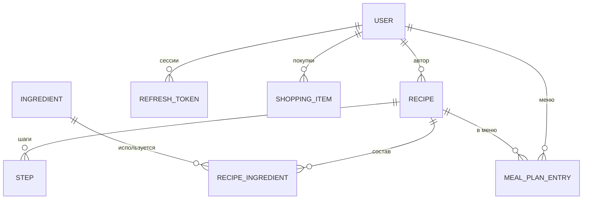

# Ассистент повара

Full-stack приложение для хранения рецептов, поиска блюд по ингредиентам, ведения списка покупок и планирования меню на неделю. Проект выполнен в рамках курса Fullstack, лабораторные работы №1–5.

| Документ | Содержание |
| --- | --- |
| [docs/ARCHITECTURE.md](docs/ARCHITECTURE.md) | Архитектура, слои, потоки данных, принятые решения |
| [docs/CODE_WALKTHROUGH.md](docs/CODE_WALKTHROUGH.md) | Разбор кода: каждый файл и путь запросов |
| [docs/DEFENSE.md](docs/DEFENSE.md) | Подготовка к защите: сценарий показа, вопросы и ответы |
| [docs/RELEASE_CHECKLIST.md](docs/RELEASE_CHECKLIST.md) | Что сделать перед запуском для реальных пользователей |
| [docs/IMAGE_CREDITS.md](docs/IMAGE_CREDITS.md) | Авторы и лицензии фотографий |

## Возможности

- Каталог рецептов с постраничной загрузкой и просмотр рецепта без регистрации.
- Создание, редактирование и удаление своих рецептов.
- Поиск рецептов по ингредиенту.
- Личный список покупок.
- Меню на неделю из любых рецептов каталога.
- Регистрация, вход, выход, смена пароля и удаление аккаунта.
- Адаптивный интерфейс с мобильным меню.

## Экраны

| Адрес | Экран | Доступ |
| --- | --- | --- |
| `/` | Главная | Все |
| `/recipes` | Каталог рецептов | Все |
| `/recipes/:id` | Рецепт | Все |
| `/search` | Поиск по ингредиентам | Все |
| `/login`, `/register` | Вход и регистрация | Все |
| `/recipes/new` | Новый рецепт | После входа |
| `/recipes/:id/edit` | Редактирование рецепта | Только автор |
| `/shopping-list` | Список покупок | После входа |
| `/meal-plan` | Меню на неделю | После входа |
| `/profile` | Профиль, свои рецепты, безопасность | После входа |

Любой другой адрес показывает страницу 404. Скриншоты лежат в [docs/screenshots](docs/screenshots): итоговое состояние показывают файлы `lr5-*.png` и `release-*.png`.

## Стек

| Часть | Технологии |
| --- | --- |
| Frontend | React 19, TypeScript, Vite 8, Material UI 9, React Router 7, шрифты Manrope и Playfair Display |
| Backend | Python 3.12, FastAPI, Pydantic 2, Uvicorn |
| База данных | PostgreSQL 18, SQLAlchemy 2, Alembic, psycopg 3 |
| Безопасность | Argon2id, JWT (PyJWT) |
| Качество | pytest, Ruff, Vitest, Oxlint, GitHub Actions |
| Запуск | Docker Compose, nginx |

## Структура проекта

```text
cooking-assistant/
├── backend/
│   ├── app/
│   │   ├── core/           # настройки, подключение к БД, безопасность, логи, лимит входа
│   │   ├── models/         # таблицы SQLAlchemy
│   │   ├── schemas/        # схемы валидации запросов и ответов
│   │   ├── crud/           # операции с данными
│   │   ├── routers/        # маршруты API
│   │   ├── dependencies.py # получение текущего пользователя
│   │   ├── main.py         # точка входа
│   │   └── seed.py         # демонстрационные данные
│   ├── migrations/         # миграции Alembic
│   ├── tests/              # автотесты
│   └── Dockerfile
├── frontend/
│   ├── src/
│   │   ├── app/            # настройка приложения, маршруты, тема оформления
│   │   ├── pages/          # страницы
│   │   ├── features/       # пользовательские действия
│   │   ├── entities/       # сущности предметной области
│   │   └── shared/         # общий код: API-клиент, утилиты, UI
│   ├── nginx/              # конфигурация production-сервера
│   └── Dockerfile
├── docs/
├── .github/workflows/      # автоматические проверки
├── docker-compose.yml
└── .env.example
```

Frontend организован по упрощённому Feature-Sliced Design. Зависимости идут в одну сторону: `app → pages → features → entities → shared`.

## Модель данных



| Таблица | Поля |
| --- | --- |
| `users` | id, email, username, hashed_password, created_at |
| `recipes` | id, title, description, image_url, cooking_time, servings, author_id, created_at |
| `ingredients` | id, name |
| `recipe_ingredients` | id, recipe_id, ingredient_id, amount |
| `steps` | id, recipe_id, order, text |
| `refresh_tokens` | id, user_id, token_hash, expires_at, revoked_at, created_at |
| `shopping_items` | id, user_id, name, done, created_at |
| `meal_plan_entries` | id, user_id, day, meal, recipe_id |

При удалении пользователя или рецепта связанные записи удаляются каскадно.

## Запуск для разработки

Нужны Python 3.12+, Node.js 22+ и PostgreSQL 15+.

### База данных

```sql
CREATE USER cook WITH PASSWORD 'cookpass';
CREATE DATABASE cooking_assistant OWNER cook;
```

### Backend

```powershell
cd backend
python -m venv .venv
.venv\Scripts\Activate.ps1
pip install -r requirements-dev.txt
copy .env.example .env
```

В файле `.env` укажите `DATABASE_URL`, `JWT_SECRET_KEY` и `SEED_USER_PASSWORD`. Секрет можно сгенерировать так:

```powershell
python -c "import secrets; print(secrets.token_urlsafe(48))"
```

Создайте таблицы, добавьте демонстрационные рецепты и запустите сервер:

```powershell
alembic upgrade head
python -m app.seed
uvicorn app.main:app --reload
```

Команда `python -m app.seed` создаёт пользователя `demo@example.com` с паролем из `SEED_USER_PASSWORD` и 14 рецептов. Повторный запуск не создаёт дублей.

Документация API (Swagger): <http://127.0.0.1:8000/docs>. В режиме `ENVIRONMENT=production` она отключена.

Если база создана до появления миграций, один раз выполните `alembic stamp 0001`, затем `alembic upgrade head`.

### Frontend

```powershell
cd frontend
npm install
npm run dev
```

Сайт откроется на <http://localhost:5173>. Запросы к `/api` Vite проксирует на backend. Другой адрес backend задаётся переменной `API_PROXY_TARGET`.

## Запуск через Docker

Скопируйте `.env.example` в `.env` и заполните значения. Для проверки на своём компьютере по HTTP укажите `REFRESH_COOKIE_SECURE=false`.

```powershell
docker compose up -d --build
docker compose exec backend python -m app.seed
```

Сайт откроется на <http://localhost:8080>. Миграции применяются автоматически при старте backend.

## Проверки

```powershell
cd backend
ruff check .
pytest
```

```powershell
cd frontend
npm run lint
npm test
npm run build
```

Тесты backend работают с PostgreSQL в отдельной схеме и не затрагивают рабочие данные. В GitHub эти проверки запускаются автоматически при каждом push в `main`.

## API

Все маршруты начинаются с `/api`. Значок 🔒 означает, что нужен access token.

| Метод и путь | Назначение |
| --- | --- |
| `GET /health` | Проверка работы сервиса и БД |
| `POST /auth/register` | Регистрация и вход |
| `POST /auth/login` | Вход, 5 неудачных попыток блокируют вход на 15 минут |
| `POST /auth/refresh` | Новый access token по cookie |
| `POST /auth/logout` | Выход и отзыв refresh token |
| `POST /auth/change-password` 🔒 | Смена пароля, остальные сессии завершаются |
| `GET /users/me` 🔒 | Текущий пользователь |
| `DELETE /users/me` 🔒 | Удаление аккаунта, нужен пароль |
| `GET /recipes/` | Страница рецептов: `ingredient`, `author_id`, `skip`, `limit` |
| `GET /recipes/{id}` | Рецепт |
| `POST /recipes/` 🔒 | Создание рецепта |
| `PATCH /recipes/{id}` 🔒 | Изменение своего рецепта |
| `DELETE /recipes/{id}` 🔒 | Удаление своего рецепта |
| `GET /ingredients/`, `GET /ingredients/{id}` | Справочник ингредиентов |
| `POST /ingredients/` 🔒 | Добавление ингредиента |
| `DELETE /ingredients/{id}` 🔒 | Удаление ингредиента, не используемого в рецептах |
| `GET /shopping-list/` 🔒 | Свой список покупок |
| `POST /shopping-list/` 🔒 | Добавление продукта |
| `PATCH /shopping-list/{id}` 🔒 | Отметка продукта |
| `DELETE /shopping-list/{id}` 🔒 | Удаление продукта |
| `GET /meal-plan/` 🔒 | Своё меню |
| `PUT /meal-plan/{day}/{meal}` 🔒 | Выбор блюда, `day` 0–6, `meal`: breakfast, lunch, dinner |
| `DELETE /meal-plan/{day}/{meal}` 🔒 | Очистка ячейки меню |

## История изменений

- **ЛР №1.** Каркас frontend на React и TypeScript, основные экраны с демонстрационными данными, маршрутизация и оформление через MUI. Цветовая схема изменена на серую, на страницу рецепта добавлено изображение.
- **ЛР №2.** Backend на FastAPI: модели SQLAlchemy, схемы Pydantic, CRUD и подключение PostgreSQL.
- **ЛР №3.** Frontend разделён по FSD, формы получили валидацию, состояния и анимации.
- **ЛР №4.** Регистрация и вход с хешами Argon2id, JWT access token, refresh token с ротацией, разделение публичных и приватных маршрутов, выход.
- **ЛР №5.** Экраны подключены к API, данные хранятся в PostgreSQL, добавлены редактирование и удаление рецептов, список покупок и меню.
- **Релиз 1.0.**
  - Схемой БД управляют миграции Alembic: `create_all` не умеет менять существующие таблицы.
  - Инфраструктурный код перенесён в `app/core`, текущий пользователь получается через `/users/me`, вместо публичного удаления по id добавлено удаление своего аккаунта с паролем.
  - Минимальная длина пароля увеличена до 8 символов, добавлены лимит попыток входа и смена пароля.
  - Каталог загружается постранично: ответ `GET /recipes/` теперь содержит `items` и `total`.
  - Добавлены страницы 404 и ошибки, мобильное меню, разделение кода по страницам, заглушка для недоступных картинок, автотесты, Docker и CI.
- **Редизайн.** Серая схема из ЛР №1 заменена тёплой: для приложения о еде она выглядит уместнее и делает интерфейс цельным. Тема вынесена в `app/theme.ts`. Новая главная страница с поиском и рецептами из БД, карточки-ссылки, страница рецепта с отдельными блоками ингредиентов и шагов, подвал, меню на неделю в одну строку. Поисковый запрос теперь хранится в адресе страницы, поэтому результат можно обновить и отправить ссылкой. Скриншоты обновлены.
