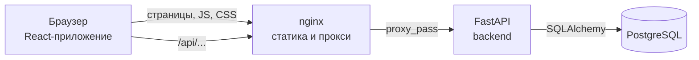
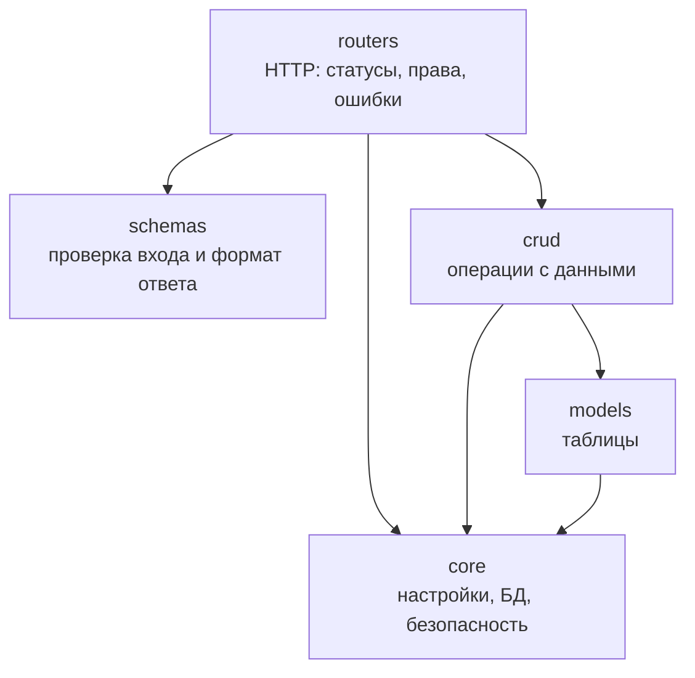
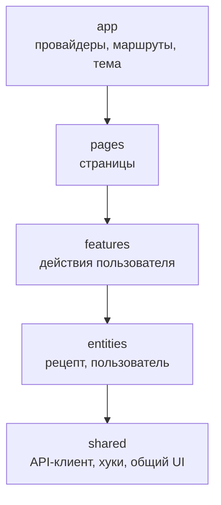
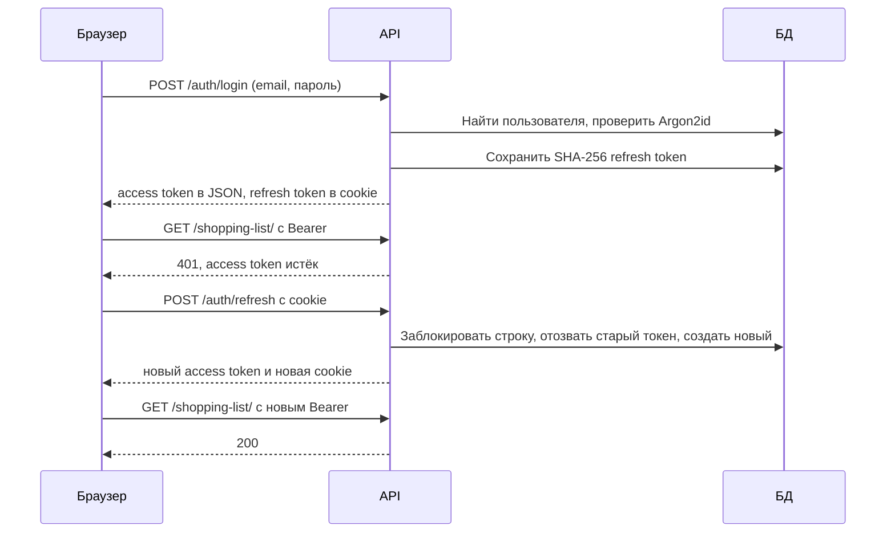

# Архитектура

## Общая схема

В разработке вместо nginx работает сервер Vite: он раздаёт код и тоже проксирует `/api`. Для браузера это один адрес, поэтому не нужен CORS, а cookie работает без дополнительных настроек.

## Backend: слои

Запрос проходит слои сверху вниз. Каждый слой знает только о нижних.

| Папка | За что отвечает | Чего не делает |
| --- | --- | --- |
| `routers/` | Принимает HTTP-запрос, проверяет права, выбирает статус ответа | Не строит запросы к БД |
| `schemas/` | Описывает, какие данные можно принять и отдать | Не знает про БД |
| `crud/` | Читает и меняет данные через SQLAlchemy | Не знает про HTTP |
| `models/` | Описывает таблицы и связи | Не содержит логики запросов |
| `core/` | Настройки, подключение к БД, хеши, токены, логи, лимит входа | Не зависит от маршрутов |

Такое разделение соответствует заданию ЛР №2: маршруты, модели и схемы, подключение к БД, операции с данными и конфигурация лежат отдельно.

Почему модель и схема разделены: модель `User` содержит `hashed_password`, а схема ответа `UserRead` нет. Поэтому хеш пароля не может случайно попасть в ответ API.

## Frontend: Feature-Sliced Design

Модуль может импортировать только нижние слои. Например, `shared/ui/Layout` не знает про авторизацию: кнопки пользователя передаются ему из `app/router.tsx` через свойство `navbarActions`.

| Слой | Содержимое |
| --- | --- |
| `app` | `App.tsx` с провайдерами, `router.tsx` с маршрутами, `theme.ts` с оформлением |
| `pages` | Страницы: собирают экран из готовых блоков. `index.ts` объявляет ленивую загрузку |
| `features/auth` | Вход, регистрация, выход, смена пароля, удаление аккаунта, защита маршрутов |
| `features/recipe-form` | Форма рецепта и её валидация |
| `features/recipe-delete` | Удаление рецепта с подтверждением |
| `features/recipe-search` | Строка поиска |
| `features/shopping-list` | Список покупок |
| `features/meal-plan` | Меню на неделю |
| `entities/recipe` | Типы, запросы к API, преобразование данных, карточка и список рецептов |
| `entities/user` | Тип пользователя |
| `shared/api` | HTTP-клиент, токен, обработка ошибок |
| `shared/lib` | `useRequest`, `useDocumentTitle`, правила email и пароля |
| `shared/ui` | `Layout`, `Navbar`, `Footer`, `Logo`, `PageHeader`, `DataState`, `PageLoader` |

## Аутентификация

Используются два токена, потому что у них разные задачи.

| | Access token | Refresh token |
| --- | --- | --- |
| Формат | JWT, подписан HS256 | Случайная строка, 64 символа |
| Срок | 15 минут | 30 дней |
| Хранение на клиенте | Переменная в памяти | HttpOnly-cookie |
| Хранение на сервере | Нигде, проверяется подпись | SHA-256 в `refresh_tokens` |
| Отзыв | Нельзя, истекает сам | Можно, поле `revoked_at` |
| Куда отправляется | Каждый запрос к защищённому API | Только `/api/auth/*` |

Ключевые свойства:

- **Кража через XSS затруднена.** JavaScript не видит cookie с флагом HttpOnly, а access token не лежит в `localStorage`.
- **CSRF.** Cookie с `SameSite=Lax` не отправляется в POST-запросах с чужих сайтов, а сама cookie ходит только на `/api/auth`.
- **Утечка БД не даёт входа.** Пароли защищены Argon2id, а refresh token хранится только как хеш.
- **Ротация.** Каждый refresh token работает один раз. `SELECT ... FOR UPDATE` не даёт обменять один токен дважды параллельно.
- **Перебор паролей.** После 5 неудачных попыток с одного IP для одного email вход блокируется на 15 минут.
- **Определение существующих email.** Ответ и время проверки одинаковы для неверного пароля и неизвестного адреса.

Права проверяются на сервере. Скрытая кнопка «Изменить» только улучшает интерфейс: защиту обеспечивает `get_own_recipe`, которая вернёт 403 даже при прямом запросе.

## Оформление

Все цвета, шрифты, скругления и общий вид компонентов MUI заданы в одном файле `app/theme.ts`. Компоненты берут значения из темы, например `primary.main`, поэтому схему можно поменять в одном месте.

Шрифты подключены как npm-пакеты и лежат вместе с приложением. Запросов к внешним сервисам шрифтов нет, поэтому политика CSP осталась строгой.

## Работа с данными на frontend

`useRequest` хранит данные, ошибку и признак загрузки. `DataState` превращает это состояние в интерфейс: индикатор, ошибка с кнопкой «Повторить», текст об отсутствии данных или содержимое. Поэтому все экраны ведут себя одинаково и не повторяют один и тот же код.

После изменения данных состояние обновляется ответом сервера, поэтому интерфейс показывает то, что реально сохранено.

## Формат данных

API использует `snake_case` (`cooking_time`), код на TypeScript использует `camelCase` (`cookingTime`). Преобразование находится в одном месте: функции `fromDto` и `toDto` в `entities/recipe/api.ts`. Если API изменится, компоненты править не придётся.

## База данных

- Схемой управляет Alembic. Изменения лежат в `backend/migrations/versions` и хранятся в Git вместе с кодом.
- На внешние ключи добавлены индексы: PostgreSQL не создаёт их автоматически, а они ускоряют выборку рецептов автора, состава и шагов.
- `selectinload` загружает ингредиенты и шаги всей страницы отдельными запросами вместо запросов на каждый рецепт (проблема N+1).
- Ограничение `uq_meal_plan_slot` на уровне БД гарантирует одно блюдо на день и приём пищи.
- `ON DELETE CASCADE` удаляет зависимые записи вместе с пользователем или рецептом.

## Фотографии рецептов

Фото загружается отдельным запросом `PUT /api/recipes/{id}/image` после сохранения рецепта. Файл принадлежит рецепту, поэтому право на загрузку проверяется так же, как право на изменение, а поле `image_url` клиент задать не может.

Сервер не доверяет расширению и типу файла из запроса. Pillow открывает файл как изображение, поворачивает его по EXIF, уменьшает до 1600 пикселей и сохраняет заново в JPEG со случайным именем. Посторонний код и метаданные с геолокацией на диск не попадают. Старый файл удаляется при замене фото, удалении рецепта или аккаунта.

Файлы лежат на диске, а в БД хранится адрес. Хранить картинки в PostgreSQL невыгодно: база быстро растёт, а раздавать файлы с диска проще. В Docker папка находится в томе `uploads`.

## Запуск в production

`docker-compose.yml` поднимает три контейнера:

| Сервис | Роль | Наружу |
| --- | --- | --- |
| `db` | PostgreSQL, данные в томе `db-data` | Закрыт |
| `backend` | FastAPI, при старте применяет миграции | Закрыт |
| `frontend` | nginx: статика, сжатие, кэш, заголовки безопасности, прокси на backend | Порт `APP_PORT` |

Сервисы запускаются по порядку благодаря проверкам `healthcheck`. Backend работает не от root. Образ frontend собирается в два этапа, поэтому Node.js не попадает в итоговый образ.

HTTPS в контейнеры не входит: сертификат обычно настраивается на внешнем балансировщике или обратном прокси хостинга. См. [RELEASE_CHECKLIST.md](RELEASE_CHECKLIST.md).

## Известные ограничения

| Ограничение | Почему приемлемо | Как развивать |
| --- | --- | --- |
| Лимит входа хранится в памяти процесса | Backend работает одним процессом | Вынести счётчики в Redis |
| Уже выданный access token действует до 15 минут после выхода | Плата за проверку без обращения к хранилищу токенов | Список отозванных токенов |
| При одновременном обновлении в двух вкладках одна может потребовать вход | Редкий случай, безопасность важнее | Короткий период действия старого токена |
| Диалог меню показывает до 100 рецептов | Достаточно для первой версии | Поиск по названию в диалоге |
| Фото лежат на диске одного сервера | Достаточно для одного сервера | Перенести в объектное хранилище |
